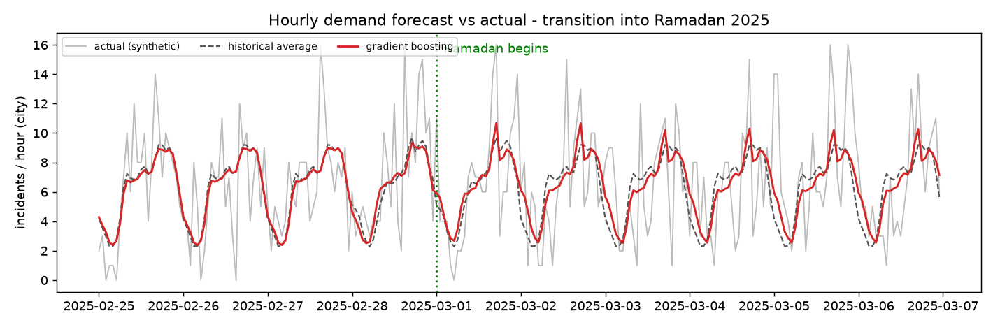
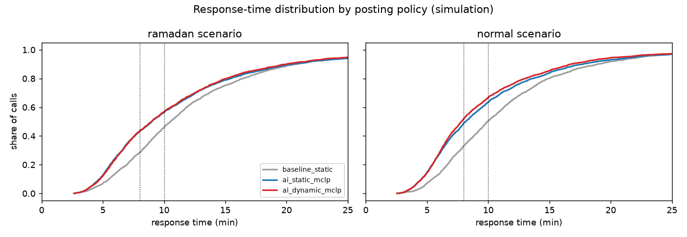
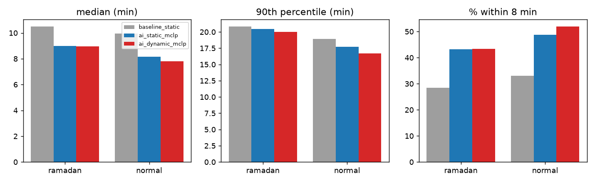
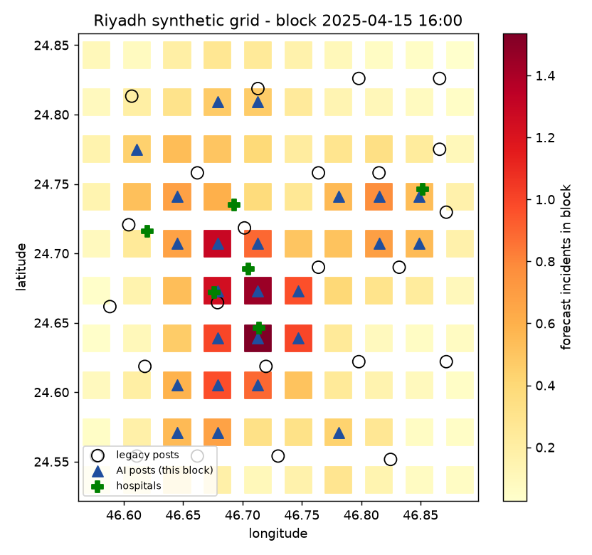
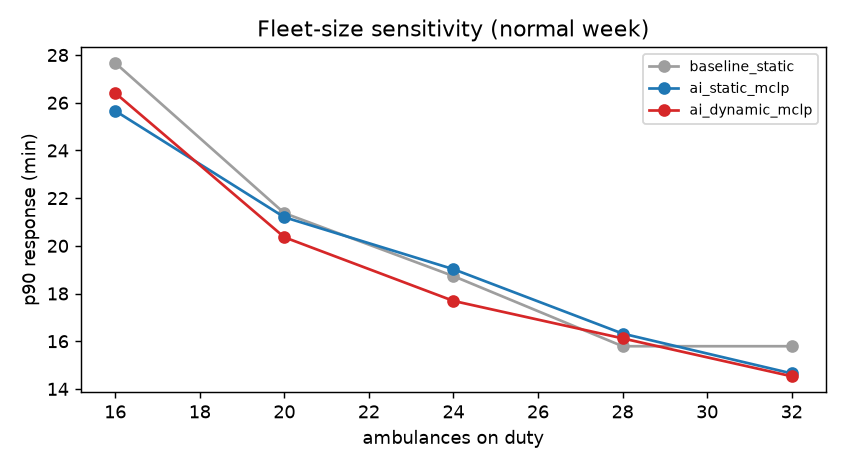

# ems-dispatch-ai

**Forecast where emergencies will happen, place ambulances where they are needed, and measure the effect in simulation. Riyadh, synthetic data.**

> Research prototype built entirely on **synthetic data**. It is not an operational dispatch system, and its triage assistant is not a validated protocol (e.g. MPDS). Nothing here is clinical advice.

Author: Mohammed Alahmadi, EMS Specialist at the Saudi Red Crescent Authority since 2012. The design choices come from day-to-day dispatch work: demand moves between commercial and residential districts during the day, Ramadan nights and the pre-iftar rush change both demand and traffic, and an idle ambulance on the wrong side of the city costs minutes.

## Pipeline
```
synthetic demand (Riyadh 10x10 grid, hourly, Ramadan/Eid/Hajj/weekend/rush-hour effects)
   -> (a) demand forecast: gradient boosting, Poisson loss   vs   historical-average baseline
   -> (c) posting optimisation: MCLP + backup + tail coverage (exact MILP, SciPy/HiGHS), re-solved every 4 h
   -> (b) dispatch: nearest *available* ambulance by road travel time (OSRM if configured, else haversine x circuity / hour-of-day speed)
   -> (d) discrete-event simulation: baseline vs AI policies -> median, p90, % within 8/10 min
   -> (e) Streamlit dashboard (map, metrics, forecast, triage)
   -> (f) Arabic/English call-note triage assistant (rule-based mock by default, optional LLM with safety override)
```

| Module | What it does |
|---|---|
| `geo.py` | Riyadh grid, haversine, hour-dependent speeds, `OSRMRouter` (`OSRM_URL`) with automatic fallback |
| `calendar.py` | Ramadan, Eid al-Fitr and Hajj dates for 2024-2026, Saudi Fri/Sat weekend |
| `synth.py` | Demand generator: hotspots (commercial / residential / industrial) whose share changes by hour and season |
| `forecast.py` | `DemandForecaster` (HistGradientBoosting, Poisson) + `HistoricalAverage` baseline |
| `coverage.py` | MCLP (Church & ReVelle 1974) with backup coverage (Hogan & ReVelle 1986) and a 15-min "tail" term; greedy fallback |
| `simulate.py` | Event simulation: queueing, scene time, transport to nearest hospital, return to post, relocations |
| `triage.py` | Structured triage `{priority, category, red_flags, language, confidence, rationale}` |
| `experiment.py` | End-to-end run; writes `results/*.json` and `docs/*.png` |
| `app.py` | Streamlit dashboard |

## Results (synthetic; `python -m ems_dispatch_ai.experiment`, about 7 min on a laptop)

### (a) Forecasting, test period 15 Feb - 14 Apr 2025 (includes Ramadan and Eid; trained on Jan 2024 - 14 Feb 2025)
| Model | Poisson deviance | Error vs true rate (MAPE) | Ramadan-only MAPE |
|---|---|---|---|
| Historical average (cell x hour x weekend) | 0.323 | 30.2 % | 39.8 % |
| **Gradient boosting (Poisson)** | **0.312** | **24.0 %** | **31.0 %** |
| Oracle (true rate) | 0.306 | 0 % | 0 % |

Counts per cell and hour are tiny (about 0.1 per hour), so raw count MAE is dominated by Poisson noise (0.113 vs 0.112). Because the data is synthetic, the true intensity is known, and the error against that rate shows how well the demand *pattern* was learned. The model recovers about 65 % of the gap between the historical average and the oracle in Poisson deviance.



### (b-d) Dispatch simulation, 24 ambulances, about 150 calls/day, 14 days per scenario
| Scenario | Policy | Median (min) | p90 (min) | % within 8 min | % within 10 min | Relocations/day |
|---|---|---|---|---|---|---|
| Normal (15-28 Apr 2025) | Legacy static posts (even spread) | 9.94 | 18.94 | 33.1 | 50.4 | 0 |
| | AI static MCLP | 8.15 | 17.73 | 48.8 | 63.5 | 0 |
| | **AI dynamic MCLP (4-h re-plan)** | **7.81** | **16.71** | **52.0** | **66.6** | 44 |
| Ramadan (8-21 Mar 2025) | Legacy static posts | 10.51 | 20.86 | 28.4 | 46.1 | 0 |
| | AI static MCLP | 8.98 | 20.45 | 43.2 | 56.2 | 0 |
| | **AI dynamic MCLP** | **8.97** | **20.01** | **43.4** | **56.8** | 40 |

In a normal fortnight the dynamic policy cuts median response by **2.1 min (-21 %)** and p90 by **2.2 min**, and raises the share of calls reached within 8 min from 33 % to 52 %. Most of the gain comes from *where* the posts are (static MCLP). Re-planning every 4 hours adds a smaller gain and costs roughly 1.8 relocation drives per ambulance per day, a real crew-fatigue trade-off. During Ramadan the time-of-day shift brings only a marginal extra benefit, because night-time demand is spread more evenly.





### Fleet-size sensitivity (normal week)
The AI posting with 20 ambulances reaches about the same % within 8 min as the legacy layout with 28 (42.5 % vs 41.1 %), but legacy-28 still has the better p90 (15.8 vs 20.4 min). Placement can stand in for some vehicles on the 8-minute target, not on the tail.


### What I learned / honest caveats
- A plain MCLP improved the median but made **p90 worse**, because it abandons hard-to-cover edge cells. Adding a 15-min tail-coverage term fixed this. The metric you optimise is the metric you get.
- Everything is synthetic: the hotspots, the speeds, the calendar effects and the scene times are assumptions. Real deployment would need CAD/AVL history, a road network (OSRM on OpenStreetMap), and prospective evaluation.
- The simulation dispatches FIFO without priority pre-emption, and relocations ignore crew breaks.

## (f) Triage assistant
```python
from ems_dispatch_ai.triage import TriageAssistant
TriageAssistant().triage("رجل عمره ٦٠ سنة عنده ألم في الصدر وتعرق").to_dict()
# {'priority': 'P1', 'category': 'chest_pain', 'red_flags': ['chest pain'], 'language': 'ar', ...}
```
Mock by default. Set `TRIAGE_LLM_BASE_URL`, `TRIAGE_LLM_MODEL` (and optionally `TRIAGE_LLM_API_KEY`) to use any OpenAI-compatible model. LLM output is schema-validated, falls back to the rules on any error, and **cannot down-triage a rule-detected P1 red flag**. No keys are committed.

## Run
```bash
pip install -r requirements.txt
pytest -q                                    # unit + integration tests
python -m ems_dispatch_ai.experiment         # full results (or --quick)
streamlit run app.py                         # dashboard
export OSRM_URL=http://localhost:5000        # optional real road times
```

## References
- Church R, ReVelle C. The maximal covering location problem. *Papers of the Regional Science Association* 1974;32:101-118.
- Hogan K, ReVelle C. Concepts and applications of backup coverage. *Management Science* 1986;32(11):1434-1444.
- Gendreau M, Laporte G, Semet F. A dynamic model and parallel tabu search heuristic for real-time ambulance relocation. *Parallel Computing* 2001;27:1641-1653.
- Matteson DS, et al. Forecasting emergency medical service call arrival rates. *Annals of Applied Statistics* 2011;5(2B):1379-1406.
- Luxen D, Vetter C. Real-time routing with OpenStreetMap data (OSRM). ACM SIGSPATIAL 2011.

## الملخص بالعربية
**ems-dispatch-ai** نظام تجريبي يستخدم الذكاء الاصطناعي لتقليل زمن وصول الإسعاف في الرياض باستخدام بيانات اصطناعية. يتنبأ النظام بعدد البلاغات المتوقعة لكل منطقة ولكل ساعة، مع مراعاة رمضان والعيد والحج وأوقات الذروة. بعد ذلك يحسب أفضل مواقع لتمركز سيارات الإسعاف عبر نموذج رياضي للتغطية القصوى (MCLP) يُعاد حسابه كل ٤ ساعات، ويرسل أقرب سيارة متاحة إلى كل بلاغ. وفي المحاكاة لأسبوعين عاديين انخفض متوسط (وسيط) زمن الاستجابة من ٩٫٩ إلى ٧٫٨ دقائق، وارتفعت نسبة البلاغات التي وصلها الإسعاف خلال ٨ دقائق من ٣٣٪ إلى ٥٢٪. يتضمن المشروع لوحة عرض تفاعلية ومساعد فرز للبلاغات يفهم العربية والإنجليزية. **نموذج بحثي على بيانات اصطناعية، وليس نظاماً تشغيلياً ولا استشارة طبية.**

## License
MIT © Mohammed Alahmadi
